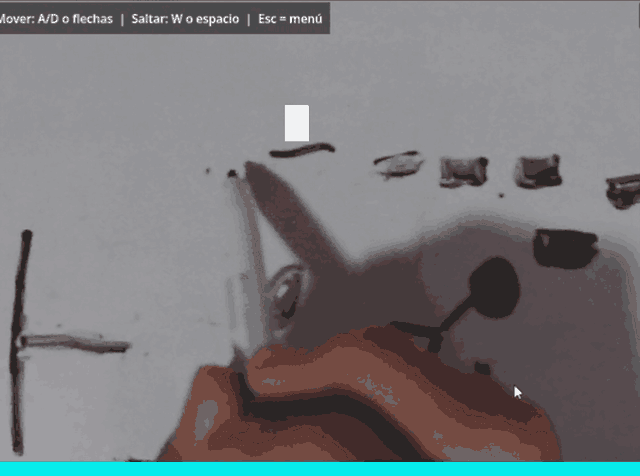
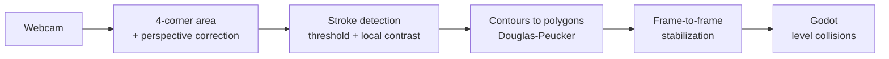

<div align="center">

# DrawinGame

**A platformer where you draw the level by hand on a sheet of paper.**


[](LICENSE)
[](https://github.com/danielfdzperez/DrawinGame/commits)
[](https://github.com/danielfdzperez/DrawinGame/stargazers)
[-D97757?logo=claude&logoColor=white)](#ai-disclosure)

<br>



</div>

---

## What is it?

You draw the level on a sheet of paper with a marker, point a **webcam** at it, and the game builds the map in **real time**. If you change the drawing, the level updates instantly.

| Stroke color | Meaning |
|---|---|
| Black | Platforms |
| Red | Hazards *(on the roadmap)* |

## How it works



- Collisions are **polygons with vertices** (simplified contours), never a pixel grid.
- The camera and vision code run on a **separate thread** and hand the polygons to Godot through a thread-safe structure.
- You can test it **without a webcam** by loading an image.

## Repository structure

| Folder | Contents |
|---|---|
| [`godot/`](godot) | The game project (Godot 4 .NET, C#) |
| [`prototype/`](prototype) | Vision prototype (WinForms + OpenCvSharp). See its [README](prototype/README.md) |
| [`AIDocs/`](AIDocs) | Technical documentation: vision, stabilization, decisions and roadmap (in Spanish) |

## Try it

### Requirements
- Windows 10/11
- [.NET 8 SDK](https://dotnet.microsoft.com/download/dotnet/8.0)
- [Godot 4.x **.NET** edition](https://godotengine.org/download/windows/)
- A webcam (optional, an image-loading mode is available)

### Vision prototype
```bash
cd prototype
dotnet run
```

### Game
1. Open Godot and click **Import**.
2. Select `godot/project.godot`.
3. Click **Build** (hammer icon), then press **F5**.

## Roadmap

- [x] Detect black drawings on white paper and turn them into polygons
- [x] Thin strokes (local contrast)
- [x] Frame-to-frame shape stabilization
- [x] Area selection with 4 corners and perspective correction
- [x] Godot project with player, camera/vision and screen flow
- [ ] Rebuild the level when the drawing changes without losing player state
- [ ] Red strokes as hazards
- [ ] Persistent calibration
- [ ] Windows export

More detail in [`AIDocs/roadmap.md`](AIDocs/roadmap.md).

## AI disclosure

This project was built **with AI assistance**: [Claude](https://claude.ai) (Anthropic) was used as an assistant to write and review code and documentation. Design decisions, testing and the direction of the project are the author's.

## License

[MIT](LICENSE) © 2026 Daniel Fernandez
